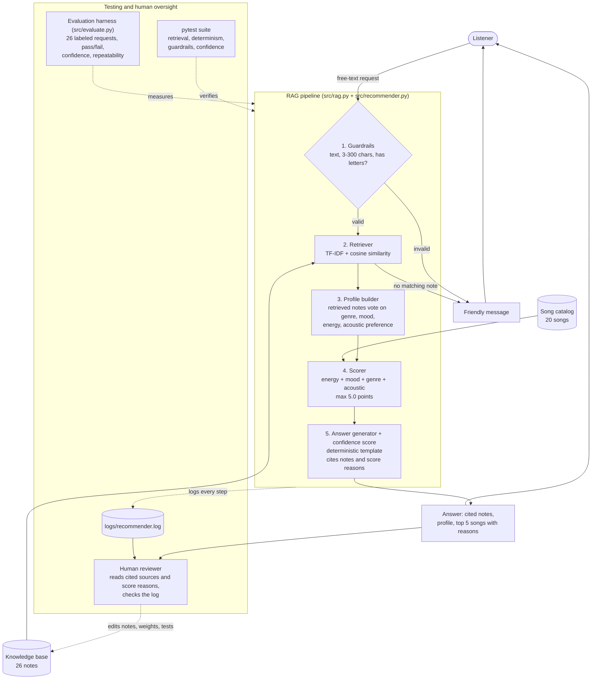

# 🎵 VibeMatch 2.0: A Music Recommender with Retrieval-Augmented Generation

Describe what you want to listen to in plain English, and VibeMatch looks up music knowledge, turns it into a taste profile, and recommends songs with a cited explanation for every pick.

```bash
python -m src.main --ask "something calm for studying"
```

## Original Project (Modules 1-3)

This project extends **VibeMatch 1.0, the "Music Recommender Simulation"** from Modules 1-3. VibeMatch 1.0 was a small command-line, content-based recommender. It loaded 20 made-up songs, compared each one to a hand-written taste profile (favorite genre, favorite mood, target energy, acoustic preference), scored every song out of 5 points, and printed the top 5 with a reason for every point awarded. I stress-tested it on six profiles and two weight experiments and documented where it failed. That work is preserved in [docs/original_project.md](docs/original_project.md) and the [Model Card](model_card.md).

## Title and Summary

**VibeMatch 2.0** removes the biggest weakness of version 1.0: a user had to already know their own profile in the system's vocabulary (`genre=lofi, mood=chill, energy=0.38`). Now a listener can type "something calm for studying" or "music for a late night drive".

The system uses **Retrieval-Augmented Generation (RAG)**. It retrieves the most relevant notes from a small music knowledge base, builds the taste profile **only from those notes**, scores the song catalog with the original scoring rule, and writes an answer that cites the notes it used. It also has input guardrails, logging, and an automated test suite.

**Why it matters:** recommenders that cannot explain themselves are hard to trust or debug. Here every recommendation can be traced back to a retrieved source and an itemized score, so a person can check the AI's reasoning instead of taking it on faith.

## Architecture Overview

The diagram is rendered from [diagrams/architecture.mmd](diagrams/architecture.mmd), and a static export is in [assets/architecture.png](assets/architecture.png).



**How data flows (input → process → output):**

1. **Guardrails** check the request is text, 3-300 characters, and contains letters. Bad input gets a friendly message and nothing else runs.
2. **Retriever** ranks the 26 notes in [data/knowledge_base.json](data/knowledge_base.json) (activities, genres, moods) against the request using TF-IDF cosine similarity. If no note is similar enough, the system says so instead of guessing.
3. **Profile builder** lets the top 3 notes vote, weighted by similarity, on genre, mood, target energy and acoustic preference. Genres and moods the catalog doesn't have are ignored.
4. **Scorer** is the original VibeMatch 1.0 rule (energy closeness 2.0, mood 1.5, genre 1.0, acoustic fit 0.5) applied to the 20-song catalog.
5. **Answer generator** attaches a **confidence score** (0 to 1, explained under Testing Summary) and writes the answer, citing the retrieved notes and the per-song score breakdown. The answer comes from a deterministic template, so the same request always produces the same output with no network or API key.

**Where people and tests check the AI:** the `pytest` suite verifies each stage, every step is logged to `logs/recommender.log`, and a human reviewer can read the cited sources and score reasons on each answer and then fix the knowledge base, weights or tests.

| File | Role |
|---|---|
| [src/rag.py](src/rag.py) | Guardrails, retriever, profile builder, answer generation, logging |
| [src/recommender.py](src/recommender.py) | Original scoring and ranking logic from VibeMatch 1.0 |
| [src/main.py](src/main.py) | Command-line interface (`--ask`, `--profile`, `--experiment`) |
| [data/knowledge_base.json](data/knowledge_base.json) | 26 retrievable music notes |
| [data/songs.csv](data/songs.csv) | 20-song catalog |
| [src/evaluate.py](src/evaluate.py) | Evaluation harness: 26 labeled requests, confidence and repeatability report |
| [docs/evaluation_results.md](docs/evaluation_results.md) | Latest evaluation results table |
| [tests/](tests) | 22 automated tests |

## Setup Instructions

Requires Python 3.10 or newer. Run all commands from the project root.

1. **Get the code**

   ```bash
   git clone https://github.com/Shahad-Hossain/applied-ai-system-project.git
   cd applied-ai-system-project
   ```

2. **Create a virtual environment** (recommended)

   ```bash
   python -m venv .venv
   source .venv/bin/activate      # Mac or Linux
   .venv\Scripts\activate         # Windows
   ```

3. **Install dependencies**

   ```bash
   pip install -r requirements.txt
   ```

   Only `pytest` is required. There are no API keys or network calls.

4. **Ask for recommendations**

   ```bash
   python -m src.main --ask "something calm for studying"
   ```

5. **Run the tests**

   ```bash
   python -m pytest
   ```

   Then run the evaluation harness, which scores the system on 26 labeled requests and prints a results table (add `--write` to save it to `docs/evaluation_results.md`):

   ```bash
   python -m src.evaluate
   ```

Other commands: `python -m src.main` runs the six original profiles, `--profile NAME` runs one, and `--experiment weight_shift|no_mood` runs the original weight experiments. Logs are written to `logs/recommender.log`.

## Sample Interactions

Outputs are from the real program (top picks shown; the full output lists 5 songs). Complete, unabridged outputs are saved in [docs/sample_outputs.md](docs/sample_outputs.md).

### 1. A calm studying request

```
$ python -m src.main --ask "something calm for studying"

What I looked up:
  - Studying and deep focus (match 0.36): Studying, homework, reading, coding and deep work call for steady, low-energy music with no sudden changes.
  - Calm and relaxed (match 0.24): When you want calm, relaxed, peaceful, mellow, laid-back or chill music, choose slow tempos and soft acoustic sounds with low energy.
  - Ambient music (match 0.13): Ambient is spacious, slow and atmospheric, with floating textures instead of beats.

Based on those notes I looked for: genre lofi, mood chill, energy near 0.35, acoustic sounds.

My picks:
  1. Library Rain by Paper Lanterns [lofi/chill] - score 4.93
     genre match (+1.0), mood match (+1.5), energy 0.35 vs target 0.35 (+2.00), acoustic fit (+0.43)
  2. Midnight Coding by LoRoom [lofi/chill] - score 4.71
     genre match (+1.0), mood match (+1.5), energy 0.42 vs target 0.35 (+1.86), acoustic fit (+0.35)
  3. Spacewalk Thoughts by Orbit Bloom [ambient/chill] - score 3.82
     mood match (+1.5), energy 0.28 vs target 0.35 (+1.86), acoustic fit (+0.46)
```

### 2. A different request retrieves different notes and gets different songs

```
$ python -m src.main --ask "pump-up songs for the gym"

What I looked up:
  - Workout and gym (match 0.49): Workout, gym, running, lifting and cardio need high-energy, fast, driving music with a strong beat.
  - Morning and good mood (match 0.10): Waking up, sunny mornings, cheerful, happy, positive and feel-good moments suit bright, upbeat pop.

Based on those notes I looked for: genre edm, mood energetic, energy near 0.91, electric/electronic sounds.

My picks:
  1. Pulse Machine by Max Pulse [edm/energetic] - score 4.89
     genre match (+1.0), mood match (+1.5), energy 0.96 vs target 0.91 (+1.90), acoustic fit (+0.48)
  2. Storm Runner by Voltline [rock/intense] - score 2.45
     energy 0.91 vs target 0.91 (+2.00), acoustic fit (+0.45)
  3. Gym Hero by Max Pulse [pop/intense] - score 2.44
     energy 0.93 vs target 0.91 (+1.96), acoustic fit (+0.47)
```

### 3. An emotional request

```
$ python -m src.main --ask "sad songs after a breakup"

What I looked up:
  - Sad and reflective (match 0.31): When you want sad, melancholy, reflective, emotional, lonely or blue music, choose slow, quiet songs with low energy and acoustic warmth.
  - Heartbreak and feeling down (match 0.30): Breakups, heartbreak, sadness, crying and feeling lonely suit slow, sad, melancholy music.

Based on those notes I looked for: genre folk, mood melancholy, energy near 0.31, acoustic sounds.

My picks:
  1. Empty Porch Light by Hollow Pines [folk/melancholy] - score 4.93
     genre match (+1.0), mood match (+1.5), energy 0.30 vs target 0.31 (+1.98), acoustic fit (+0.45)
  2. Broken Signal by Static Lilies [indie pop/melancholy] - score 3.22
     mood match (+1.5), energy 0.55 vs target 0.31 (+1.52), acoustic fit (+0.20)
```

### 4. Guardrails: bad input and unknown requests

```
$ python -m src.main --ask "a"
[invalid] Request is empty or too short.

$ python -m src.main --ask "asdfgh qwerty"
[no_match] I couldn't find anything in my music notes for that. Try something like: "something calm for studying"; "pump-up songs for the gym"; "sad songs after a breakup"; "music for a late night drive"
```

### 5. Low confidence: the system says when it is unsure

```
$ python -m src.main --ask "classical piano"
...
Confidence: 0.43 (low) - treat these picks with caution.
Note: My notes don't cover: classical. Those words were ignored.

$ python -m src.main --ask "something sad but also really loud"
...
Confidence: 0.50 (medium)
Note: Your request mixes very different energy levels, so I blended them; the result may satisfy neither half.
```

## Design Decisions

- **RAG that drives the result.** The profile is built only from retrieved notes, so the answer is grounded in data I can read, edit and test. The song list always comes from the scorer, so the system cannot recommend a song that is not in the catalog.
- **Reused the original scorer.** The new feature changes how the profile is created, not how songs are scored. That kept the proven, explainable scoring rule from Modules 1-3 and made it easy to tell whether a change came from retrieval or from scoring.
- **Plain-Python TF-IDF instead of embeddings.** There is no model download, no API key and no extra dependency, and results are fully deterministic, so tests can assert exact behavior. The trade-off is that it matches words, not meaning (see Testing Summary).
- **No generative model, on purpose.** I first built an optional Claude-written explanation and then removed it. The template already explains every pick from the retrieved notes and the score breakdown, so a language model added an API key, a network dependency, cost, prompt-injection risk and non-deterministic output, and I could not test it here. Removing it kept the project simple, reproducible and fully testable offline.
- **A small hand-written knowledge base.** 26 short notes are easy to audit and fix, but they limit what the system understands. Each note carries structured hints (genre, mood, energy, acoustic) so retrieved text can directly drive the profile.
- **Guardrails fail safe.** Bad input, no matching note, a malformed data file, and any unexpected error each produce a clear message or error result instead of a crash or a made-up answer. Every step is logged.
- **Weighted voting for blended requests.** When several notes match, they vote by similarity. That handles "relaxing jazz for dinner" well, but it can average conflicting requests into a middle that satisfies neither half (see Testing Summary).

## Testing Summary

**In short:** 22 of 22 automated tests pass. The evaluation harness passes 25 of 25 expected-to-pass requests, repeats identically 15 of 15 times, and has 1 documented known failure. Mean confidence was 0.83 on answerable requests and 0.38 on out-of-scope requests that were still answered. Adding confidence scoring fixed the main silent failure I found in manual testing.

The system is checked four ways:

1. **Automated tests.** `python -m pytest` runs 22 tests ([tests/test_rag.py](tests/test_rag.py) and the original [tests/test_recommender.py](tests/test_recommender.py)): retrieval finds the right note and returns nothing for gibberish; different retrieved notes change the recommendations; answers cite their sources; results are repeatable; every guardrail rejects bad input; a corrupt knowledge base raises a clear error; and confidence behaves as intended. One test runs the whole evaluation suite as a regression check.
2. **Confidence scoring.** Every answer ends with a score from 0 to 1: `strength x coverage`, where *strength* is how well the best note matches (similarity relative to a strong match) and *coverage* is the share of the request's words that appear anywhere in the knowledge base. Score is halved when the retrieved notes disagree about energy. Below 0.45 the answer is labeled "treat these picks with caution", and the words that weren't understood are listed.
3. **Logging and error handling.** Requests, retrieved notes, profiles, low-confidence warnings and exceptions are written to `logs/recommender.log`. Every failure path returns a message or an error result instead of crashing.
4. **Evaluation harness.** `python -m src.evaluate` runs 26 labeled requests through the real pipeline and writes [docs/evaluation_results.md](docs/evaluation_results.md), a table with each input, criteria, result and confidence.

| Group | Passed | What it checks |
|---|---|---|
| Answerable requests | 15 / 15 | Correct note retrieved and a matching genre ranked first |
| Out-of-scope requests | 4 / 4 | Refused, or answered with low confidence ("classical piano", "death metal screaming", "asdfgh qwerty", "k-pop idol groups") |
| Bad input | 5 / 5 | Empty, one letter, digits only, 400 characters, `None` all rejected |
| Conflicting request | 1 / 1 | "Something sad but also really loud" is flagged as mixing energy levels |
| Known limitation | 0 / 1 | Same request still returns a quiet song first (energy 0.30, wanted 0.6 or more) |

**What worked:** retrieval was right on every answerable request I tried. Confidence separated the two groups (0.83 vs 0.38), the no-match and guardrail paths behaved as designed, and the confidence warnings turned two silent failures (the "classical piano" request that returned jazz with no explanation, and the sad-but-loud blend) into visible ones.

**What didn't work, and what I learned:**

- **Flagging is not fixing.** The sad-but-loud request is detected and warned about, but the top song is still a quiet folk track. Averaging conflicting notes is a design limit, and the right fix is probably to ask the user which half matters more.
- **Confidence is conservative.** "Feeling confident getting ready to go out" retrieved exactly the right note and a hip hop song, yet scored only 0.33 because several of its words aren't in the notes. A correct answer can look unsure.
- **Confidence can't catch everything.** "Chill beats for a rainy afternoon" returned jazz at 0.64 (medium). I accepted jazz or lofi there, since both fit, but the user may have wanted lofi.
- **The evaluation set is not independent.** I wrote it after trying many requests by hand, so a 25 of 25 pass rate overstates how well it would do on a stranger's requests. It is a regression check and a demonstration, not an unbiased accuracy estimate. A fair measurement needs requests collected from other people.

The main lesson is that tests prove the system is repeatable and safe, but a system also has to know when it might be wrong. The most useful bugs came from typing requests I hadn't designed for, and the most useful fix was making the system admit uncertainty.

## Reflection

Building this showed me that adding AI to a system is mostly about what you let it control. Retrieval was only useful once the retrieved text actually changed the profile and the picks, instead of being printed beside an unchanged answer. Guardrails and logs took as much thought as the retrieval itself, and the failures I found came from realistic inputs, not from the code. It also reinforced that a transparent, explainable score is what makes an AI system reviewable by a person.

My full responsible-AI reflection (how I collaborated with AI, a suggestion I accepted and one I revised, and the system's limitations) is in the [Model Card](model_card.md).

## More Documentation

- [Model Card](model_card.md): intended use, biases, evaluation and responsible-AI reflection
- [docs/original_project.md](docs/original_project.md): full VibeMatch 1.0 write-up, stress tests and weight experiments
- [docs/evaluation_results.md](docs/evaluation_results.md): latest evaluation results table
- [docs/sample_outputs.md](docs/sample_outputs.md): raw captured output of the commands above, including the test run
- [diagrams/architecture.mmd](diagrams/architecture.mmd): architecture diagram source (Mermaid)
