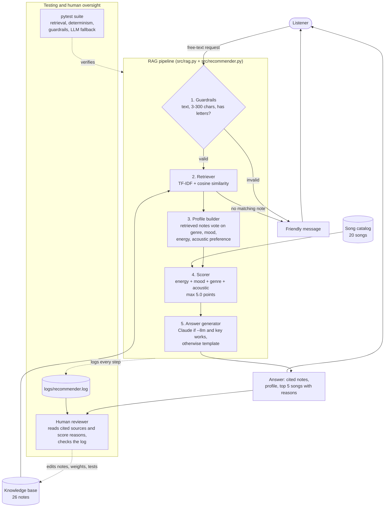

# 🎵 VibeMatch 2.0: A Music Recommender with Retrieval-Augmented Generation

Describe what you want to listen to in plain English, and VibeMatch looks up music knowledge, turns it into a taste profile, and recommends songs with a cited explanation for every pick.

```bash
python -m src.main --ask "something calm for studying"
```

## Original Project (Modules 1-3)

This project extends **VibeMatch 1.0, the "Music Recommender Simulation"** from Modules 1-3. VibeMatch 1.0 was a small command-line, content-based recommender. It loaded 20 made-up songs, compared each one to a hand-written taste profile (favorite genre, favorite mood, target energy, acoustic preference), scored every song out of 5 points, and printed the top 5 with a reason for every point awarded. I stress-tested it on six profiles and two weight experiments and documented where it failed. That work is preserved in [docs/original_project.md](docs/original_project.md) and the [Model Card](model_card.md).

## Title and Summary

**VibeMatch 2.0** removes the biggest weakness of version 1.0: a user had to already know their own profile in the system's vocabulary (`genre=lofi, mood=chill, energy=0.38`). Now a listener can type "something calm for studying" or "music for a late night drive".

The system uses **Retrieval-Augmented Generation (RAG)**. It retrieves the most relevant notes from a small music knowledge base, builds the taste profile **only from those notes**, scores the song catalog with the original scoring rule, and writes an answer that cites the notes it used. It also has input guardrails, logging, and an automated test suite.

**Why it matters:** recommenders that cannot explain themselves are hard to trust or debug. Here every recommendation can be traced back to a retrieved source and an itemized score, so a person can check the AI's reasoning instead of taking it on faith.

## Architecture Overview

The diagram is rendered from [diagrams/architecture.mmd](diagrams/architecture.mmd), and a static export is in [assets/architecture.png](assets/architecture.png).



**How data flows (input → process → output):**

1. **Guardrails** check the request is text, 3-300 characters, and contains letters. Bad input gets a friendly message and nothing else runs.
2. **Retriever** ranks the 26 notes in [data/knowledge_base.json](data/knowledge_base.json) (activities, genres, moods) against the request using TF-IDF cosine similarity. If no note is similar enough, the system says so instead of guessing.
3. **Profile builder** lets the top 3 notes vote, weighted by similarity, on genre, mood, target energy and acoustic preference. Genres and moods the catalog doesn't have are ignored.
4. **Scorer** is the original VibeMatch 1.0 rule (energy closeness 2.0, mood 1.5, genre 1.0, acoustic fit 0.5) applied to the 20-song catalog.
5. **Answer generator** writes the answer, citing the retrieved notes and the per-song score breakdown. With `--llm`, Claude writes the explanation from the retrieved notes; if that is unavailable it falls back to a deterministic template.

**Where people and tests check the AI:** the `pytest` suite verifies each stage, every step is logged to `logs/recommender.log`, and a human reviewer can read the cited sources and score reasons on each answer and then fix the knowledge base, weights or tests.

| File | Role |
|---|---|
| [src/rag.py](src/rag.py) | Guardrails, retriever, profile builder, answer generation, logging |
| [src/recommender.py](src/recommender.py) | Original scoring and ranking logic from VibeMatch 1.0 |
| [src/main.py](src/main.py) | Command-line interface (`--ask`, `--profile`, `--experiment`) |
| [data/knowledge_base.json](data/knowledge_base.json) | 26 retrievable music notes |
| [data/songs.csv](data/songs.csv) | 20-song catalog |
| [tests/](tests) | 19 automated tests |

## Setup Instructions

Requires Python 3.10 or newer. Run all commands from the project root.

1. **Get the code**

   ```bash
   git clone https://github.com/Shahad-Hossain/applied-ai-system-project.git
   cd applied-ai-system-project
   ```

2. **Create a virtual environment** (recommended)

   ```bash
   python -m venv .venv
   source .venv/bin/activate      # Mac or Linux
   .venv\Scripts\activate         # Windows
   ```

3. **Install dependencies**

   ```bash
   pip install -r requirements.txt
   ```

   Only `pytest` is required. The `anthropic` package is optional and used only by `--llm`.

4. **Ask for recommendations**

   ```bash
   python -m src.main --ask "something calm for studying"
   ```

5. **Run the tests**

   ```bash
   python -m pytest
   ```

6. **Optional: Claude-written explanations.** Set an API key, then add `--llm`. Without a key, or if the call fails, the app falls back to the built-in template and says so.

   ```bash
   export ANTHROPIC_API_KEY=your-key      # PowerShell: $env:ANTHROPIC_API_KEY = "your-key"
   python -m src.main --ask "something calm for studying" --llm
   ```

Other commands: `python -m src.main` runs the six original profiles, `--profile NAME` runs one, and `--experiment weight_shift|no_mood` runs the original weight experiments. Logs are written to `logs/recommender.log`.

## Sample Interactions

Outputs are from the real program (top picks shown; the full output lists 5 songs).

### 1. A calm studying request

```
$ python -m src.main --ask "something calm for studying"

What I looked up:
  - Studying and deep focus (match 0.36): Studying, homework, reading, coding and deep work call for steady, low-energy music with no sudden changes.
  - Calm and relaxed (match 0.24): When you want calm, relaxed, peaceful, mellow, laid-back or chill music, choose slow tempos and soft acoustic sounds with low energy.
  - Ambient music (match 0.13): Ambient is spacious, slow and atmospheric, with floating textures instead of beats.

Based on those notes I looked for: genre lofi, mood chill, energy near 0.35, acoustic sounds.

My picks:
  1. Library Rain by Paper Lanterns [lofi/chill] - score 4.93
     genre match (+1.0), mood match (+1.5), energy 0.35 vs target 0.35 (+2.00), acoustic fit (+0.43)
  2. Midnight Coding by LoRoom [lofi/chill] - score 4.71
     genre match (+1.0), mood match (+1.5), energy 0.42 vs target 0.35 (+1.86), acoustic fit (+0.35)
  3. Spacewalk Thoughts by Orbit Bloom [ambient/chill] - score 3.82
     mood match (+1.5), energy 0.28 vs target 0.35 (+1.86), acoustic fit (+0.46)
```

### 2. A different request retrieves different notes and gets different songs

```
$ python -m src.main --ask "pump-up songs for the gym"

What I looked up:
  - Workout and gym (match 0.49): Workout, gym, running, lifting and cardio need high-energy, fast, driving music with a strong beat.
  - Morning and good mood (match 0.10): Waking up, sunny mornings, cheerful, happy, positive and feel-good moments suit bright, upbeat pop.

Based on those notes I looked for: genre edm, mood energetic, energy near 0.91, electric/electronic sounds.

My picks:
  1. Pulse Machine by Max Pulse [edm/energetic] - score 4.89
     genre match (+1.0), mood match (+1.5), energy 0.96 vs target 0.91 (+1.90), acoustic fit (+0.48)
  2. Storm Runner by Voltline [rock/intense] - score 2.45
     energy 0.91 vs target 0.91 (+2.00), acoustic fit (+0.45)
  3. Gym Hero by Max Pulse [pop/intense] - score 2.44
     energy 0.93 vs target 0.91 (+1.96), acoustic fit (+0.47)
```

### 3. An emotional request

```
$ python -m src.main --ask "sad songs after a breakup"

What I looked up:
  - Sad and reflective (match 0.31): When you want sad, melancholy, reflective, emotional, lonely or blue music, choose slow, quiet songs with low energy and acoustic warmth.
  - Heartbreak and feeling down (match 0.30): Breakups, heartbreak, sadness, crying and feeling lonely suit slow, sad, melancholy music.

Based on those notes I looked for: genre folk, mood melancholy, energy near 0.31, acoustic sounds.

My picks:
  1. Empty Porch Light by Hollow Pines [folk/melancholy] - score 4.93
     genre match (+1.0), mood match (+1.5), energy 0.30 vs target 0.31 (+1.98), acoustic fit (+0.45)
  2. Broken Signal by Static Lilies [indie pop/melancholy] - score 3.22
     mood match (+1.5), energy 0.55 vs target 0.31 (+1.52), acoustic fit (+0.20)
```

### 4. Guardrails: bad input and unknown requests

```
$ python -m src.main --ask "a"
[invalid] Request is empty or too short.

$ python -m src.main --ask "asdfgh qwerty"
[no_match] I couldn't find anything in my music notes for that. Try something like: "something calm for studying"; "pump-up songs for the gym"; "sad songs after a breakup"; "music for a late night drive"
```

## Design Decisions

- **RAG over a plain LLM.** The profile is built only from retrieved notes, so the answer is grounded in data I can read, edit and test. A chat model asked to "recommend songs" could invent songs that are not in the catalog. Here the model (or template) can only explain songs the scorer actually ranked.
- **Reused the original scorer.** The new feature changes how the profile is created, not how songs are scored. That kept the proven, explainable scoring rule from Modules 1-3 and made it easy to tell whether a change came from retrieval or from scoring.
- **Plain-Python TF-IDF instead of embeddings.** There is no model download, no API key and no extra dependency, and results are fully deterministic, so tests can assert exact behavior. The trade-off is that it matches words, not meaning (see Testing Summary).
- **Offline by default, LLM optional.** Retrieval, profile building and the template answer need no network. The `--llm` flag is a thin layer that always falls back, so a missing key or network error never breaks the app.
- **A small hand-written knowledge base.** 26 short notes are easy to audit and fix, but they limit what the system understands. Each note carries structured hints (genre, mood, energy, acoustic) so retrieved text can directly drive the profile.
- **Guardrails fail safe.** Bad input, no matching note, a malformed data file, and any unexpected error each produce a clear message or error result instead of a crash or a made-up answer. Every step is logged.
- **Weighted voting for blended requests.** When several notes match, they vote by similarity. That handles "relaxing jazz for dinner" well, but it can average conflicting requests into a middle that satisfies neither half (see Testing Summary).

## Testing Summary

**Automated:** `python -m pytest` runs 19 tests, all passing. The 17 new tests in [tests/test_rag.py](tests/test_rag.py) check that:

- retrieval finds the right note ("pump-up songs for the gym" finds the Workout note) and returns nothing for gibberish;
- different retrieved notes change the recommendations (calm study request gets lofi at energy below 0.5; the gym request gets EDM above 0.5);
- answers cite every retrieved note;
- the same request always gives the same result;
- every guardrail rejects bad input (`None`, numbers, empty, too short, no letters, over 300 characters);
- `--llm` falls back to the template when no API key is set;
- a corrupt knowledge base raises a clear error.

**What worked:** clear requests tied to an activity, genre or mood ("calm for studying", "angry music to vent", "workout music", "something to fall asleep to") retrieved the right note and ranked a matching song first. The guardrails and the no-match path behaved as designed.

**What didn't work, found by trying other requests by hand:**

- **Words, not meaning.** "classical piano" matched the *Jazz* note only because both mention piano. The system then recommended jazz without saying the catalog has no classical music.
- **Conflicting requests get averaged.** "Something sad but also really loud" blended the sad notes (energy about 0.32) with the intense note (about 0.90) into a target of 0.43. The result is a quiet folk song first, and the "loud" half is mostly lost.
- **Near-miss retrieval.** "Chill beats for a rainy afternoon" retrieved the *Rainy day* note ahead of the *Lofi* note and returned jazz, where lofi would probably suit better.
- **Not measured:** there is no labeled evaluation set, so I checked retrieval quality by reading results rather than computing a score. The `--llm` path has not been run against the live API.

**What I learned:** tests are good at proving the system is repeatable and safe, but they don't prove it is *right*. The most useful discoveries came from typing requests I hadn't designed for. The next improvements are a "this catalog has nothing like that" warning when the best match is weak, and a small labeled set of requests for measuring retrieval quality.

## Reflection

Building this showed me that adding AI to a system is mostly about what you let it control. Retrieval was only useful once the retrieved text actually changed the profile and the picks, instead of being printed beside an unchanged answer. Guardrails and logs took as much thought as the retrieval itself, and the failures I found came from realistic inputs, not from the code. It also reinforced that a transparent, explainable score is what makes an AI system reviewable by a person.

My full responsible-AI reflection (how I collaborated with AI, a suggestion I accepted and one I revised, and the system's limitations) is in the [Model Card](model_card.md).

## More Documentation

- [Model Card](model_card.md): intended use, biases, evaluation and responsible-AI reflection
- [docs/original_project.md](docs/original_project.md): full VibeMatch 1.0 write-up, stress tests and weight experiments
- [diagrams/architecture.mmd](diagrams/architecture.mmd): architecture diagram source (Mermaid)
